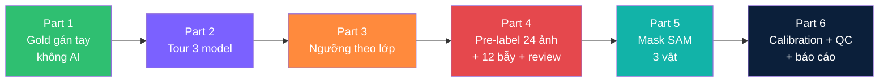

<p align="center">
  
</p>

# Day 08 Lab — 2A202603226 - Lương Văn Quyến
## 1. Model và recipe (Part 2–3)

| Lớp | Model + cỡ | Ngưỡng | Vì sao |
|---|---|---|---|
| person / motorbike / car | YOLO26m, r05 | 0.3 | Quét ngưỡng chưa đạt recall mục tiêu 90%, giữ ngưỡng mặc định |
| bicycle | YOLO26m, r05 | 0.2 | Recall 100%, precision 83% trên 5 đối tượng gold |
| bus / truck | YOLO26m, r05 | 0.3 | Gold chỉ có 1 bus và 0 truck, chưa đủ mẫu chọn ngưỡng riêng |
| three_wheeler | YOLOE-26s-seg, r06; prompt: tuk-tuk, cyclo, cargo tricycle | 0.15 | Recall 100%, precision 78% trên 7 đối tượng gold |

- Lệnh gộp dưới đây được dựng lại từ cấu hình và đã đối chiếu khớp các box trong file merged đã lưu:

```powershell
python scripts/merge_prelabels.py work/prelabel/yoloe_all/pre.coco.json work/prelabel/y26_all/pre.coco.json --thr "bicycle=0.2,three_wheeler=0.15" --conf 0.3 --iou 0.6 --split "batch,gold" --out work/prelabel/merged_review/pre.coco.json
```

- SAM sử dụng: SAM 2.1 base, sam2.1_b.pt. Lượt r04 chạy được trên CPU, trung bình 3.96 giây/ảnh. Chưa so sánh các phiên bản để kết luận phiên bản nào tốt nhất.
- YOLO26 với ánh xạ COCO hiện tại không có three_wheeler; đổi confidence không bổ sung được lớp này. Recipe dùng YOLOE và ưu tiên kết quả YOLOE khi gộp.
- Ví dụ điểm thấp nhưng khớp gold: img_012.jpg có box three_wheeler của YOLOE với confidence khoảng 0.194, IoU khoảng 0.822 với box cùng lớp trong gold.
- Giới hạn: chọn và đánh giá ngưỡng trên cùng 4 ảnh gold nên số đo có tính lạc quan. Tour YOLO26 dùng cỡ s, nguồn pre-label toàn bộ ảnh dùng cỡ m.

## 2. AI error profile

| Trạng thái | Số | Tỉ lệ | Mẫu số |
|---|---|---|---|
| accepted | 441 | 84,2% | 524 box máy |
| edited | 21 | 4,0% | 524 box máy |
| deleted | 52 | 9,9% | 524 box máy |
| added | 24 | 4,9% | 486 đối tượng sau duyệt |

- Nguồn: qc/review_stats.json. Số đo phản ánh lượt so sánh batch_reviewed với pre-label, không phải số đo lại trên release sau sửa QC.
- So với gold: precision 54/68 = 79,4%; recall 54/71 = 76,1%, trên 4 ảnh gold.
- Three_wheeler có 21 box bị xóa và 7 box chỉnh sửa, cần chú ý box thừa và vị trí box. Chưa có đủ bằng chứng để kết luận nguyên nhân cho từng box bị xóa.

## 3. Thiên kiến tự động hóa và ảnh bẫy

- Lượt đầu bắt 7/12 = 58,3%; sau sửa đạt 11/12 = 91,7%. File review_stats còn ghi img_023.jpg, loại loose, là bẫy lọt.
- Lượt đầu accepted đạt 88,0% nhưng chỉ bắt 7/12 bẫy, cho thấy giữ lại nhiều box không đồng nghĩa đã phát hiện đủ lỗi.
- Lượt sửa có xem danh sách bẫy lọt và được ChatGPT hỗ trợ đọc code, xác định vùng tham chiếu; không phải phép đánh giá mù độc lập.
- Chưa có nhật ký thao tác đủ chi tiết để xác định chắc chắn bước checklist bị bỏ qua ở lượt đầu.

## 4. Máy có đáng dùng không?

- Theo time_log.csv: gán tay 30/4 = 7,5 phút/ảnh; review ban đầu 30/24 = 1,25 phút/ảnh. Chưa tính đủ thời gian sửa bổ sung. Việc gán gold trước giúp tôi quen cảnh.
- AI giúp giảm công sức tạo nhãn ban đầu vì giữ lại được nhiều box. Tuy nhiên vẫn phải kiểm từng ảnh; lượt đầu chỉ bắt 7/12 bẫy.
- Ba quy tắc tôi sẽ áp dụng:
  1. Ẩn nhãn và quét toàn bộ ảnh trước khi xem box máy.
  2. Kiểm bỏ sót, thừa, sai lớp và box không sát; không bỏ qua box có confidence cao.
  3. Ghi riêng thời gian review và sửa bổ sung, kiểm kết quả sau mỗi lần export.

## 5. Mask SAM cho 3 vật

| Ảnh | SAM | Số click | Phạm vi mask | Lỗi quan sát | File |
|---|---|---|---|---|---|
| img_013 – tuk-tuk | SAM 2.1 base | 2 dương + 1 âm, có box | Loại được phần lớn người lái | Lấy thừa bánh xe máy bên phải và còn dính một phần người lái | masks/tuktuk_img013_v2.jpg |
| img_013 – người lái | SAM 2.1 base | 2 dương + 1 âm, có box | Người lái riêng | Biên tay, dép và vùng bị che chưa thật sát | masks/driver_img013.jpg |
| img_013 – người áo sọc | SAM 2.1 base | 2 dương + 1 âm, có box | Người áo sọc riêng | Thiếu một mảng nhỏ trên áo gần vai | masks/passenger_img013.jpg |

- Ba vật ở cùng ảnh. Số click là số điểm trong từng lệnh tạo kết quả được chọn.
- Tuk-tuk v1 chỉ chọn logo. V2 chọn được phần lớn xe. V3 lấy thừa nhiều phần người lái nên giữ v2 làm kết quả chính.
- Theo mục 4.2, mask cần bám phần nhìn thấy và tách riêng vật. SAM còn lỗi ở vùng bị che và các vật sát nhau.
- Thử nghiệm sử dụng sam2_points.py offline; chưa thử Interactor trong CVAT.

## 6. Calibration

- Có 3 quyết định trong qc/calibration_decisions.csv: CAL-01 từ loi_may, CAL-02 từ cau_hoi_mo, CAL-03 từ bay_lot.
- CAL-02 làm rõ kính chắn gió và khoảng hở trong ảnh img_013.jpg; nội dung đã đưa vào guideline v1.1.
- CAL-01 là lỗi mask lấy thừa vật bên cạnh; quy tắc tách vật đã có.
- CAL-03 yêu cầu kiểm lại box nhỏ sát mép ảnh theo quy tắc hiện có.
- Không đổi guideline chỉ để hợp thức hóa lỗi máy hoặc lỗi review.

## 7. QC và quyết định

- Vòng đầu ghi nhận 7/190 đối tượng lỗi và 5/8 ảnh lỗi, dẫn đến Rework.
- Sau sửa, mẫu mới gồm 6 ảnh: 1 ca khó và 5 ảnh ngẫu nhiên, seed 42; tổng cộng 94 đối tượng.
- Người kiểm: Luong Van Quyen; ChatGPT hỗ trợ xem ảnh và soạn phiếu. Hạn chế: tôi vừa duyệt vừa kiểm.
- Vòng sau: lỗi theo đối tượng 0/94 = 0%; ảnh có lỗi 0/6 = 0%. Phiếu không ghi nhận loại lỗi.
- Mẫu hai vòng khác nhau, không dùng chênh lệch phần trăm để khẳng định mức cải thiện của toàn bộ lô.
- Cận trên 95% Wilson của tỉ lệ ảnh lỗi ở vòng sau khoảng 39%; mẫu nhỏ chưa chứng minh toàn bộ lô có lỗi dưới 2%.
- Bắt bẫy sau sửa đạt 11/12 = 91,7%; đây là lượt đã biết vị trí bẫy.
- Script tính số liệu theo phiếu, không tự xác nhận box sát vật, lớp đúng thực tế hoặc mọi vật bỏ sót.
- Nguồn: qc/qc_report_auto.md và qc/qc_review.csv.

**Quyết định: Release**, ngày 2026-11-18.

Sau sửa và kiểm lại, mẫu không ghi nhận lỗi và không còn vấn đề guideline chưa chốt. Quyết định giới hạn theo quy trình và mẫu kiểm của bài, không khẳng định toàn bộ lô hoàn toàn không có lỗi.

## 8. Ghi chú cá nhân

- ChatGPT hỗ trợ giải thích quy trình, đọc code và JSON, xem mask, gợi ý lỗi QC và soạn nội dung. Các bước lưu nhãn và quyết định cuối do tôi thực hiện, xác nhận.
- Tình trạng gold trước khi dùng AI: chưa có nhật ký đủ chi tiết trong repo để xác minh; cần tự xác nhận trung thực quá trình gán ban đầu.
- Môi trường: Windows, CVAT Docker 2.81.0. Các log model đã lưu ghi device cpu.
- Repo có cache và log chạy model; chỉ các file này chưa đủ để xác minh có sử dụng cache làm nguồn kết quả hay không. Cần tự xác nhận theo quá trình thực tế.
- Vướng mắc: cần chọn đúng đối tượng và export lại sau sửa; phiếu QC trống từng tạo số 0 lỗi dù chưa kiểm.
- Lần sau cần ghi đủ thời gian các lượt sửa, lưu nhận xét ngay sau mỗi lần thử và kiểm ảnh trước khi tin vào gợi ý của script.<p align="center">
  
  
  
  

  
  <a href="https://colab.research.google.com/github/VinUni-AI20k/K5-L23-Day08-AI-Assisted-Labeling/blob/main/notebooks/day08_colab.ipynb"></a>
</p>

> **Máy gán sẵn, người sửa.** Nhanh hơn vẽ tay — nhưng **bạn** vẫn là chốt chặn chất lượng, và bạn phải **đo** được điều đó.

## Bạn sẽ làm gì

Trong **4 giờ trên lớp** (cài đặt làm trước ~45 phút): chạy ba công cụ pre-label **từ đơn giản đến phức tạp** (YOLO26 → SAM → YOLOE), đưa kết quả vào **CVAT**, **review có quy trình** (có ảnh bẫy để đo chính bạn), rồi **calibration** lại nhãn và guideline.

| Việc | Công cụ |
|---|---|
| Detector danh mục cố định | **YOLO26** |
| Click ra mask (**SAM bắt buộc**, chọn SAM 1 · 2.1 · 3) | **SAM** |
| Gõ chữ ra box + mask (open-vocabulary) | **YOLOE** (nâng cao: Grounding DINO, OWLv2, SAM 3) |
| Đưa nhãn vào CVAT & review | CVAT: import · AI Tools · `cvat-cli` |
| Đo & calibration | `review_stats` · `threshold_sweep` · QC · Release / Hold / Rework |


## Lộ trình




## Bộ dữ liệu: phố châu Á, và những chiếc xe mà COCO không biết tên


36 ảnh (Việt Nam, Thái Lan; CC BY / CC BY-SA / CC0): **gold 4** (gán tay) · **batch 24** (lô thật) · **8 ảnh còn lại** để thử model và cho bài nâng cao. Khoảng 28% ảnh có **tuk-tuk, xích lô, ba gác** (lớp `three_wheeler`): model COCO gọi chúng là `car` / `truck`.


*Cùng một ảnh: (1) YOLO26 gọi tuk-tuk là car/truck · (2) YOLOE gõ chữ tìm đúng nhưng box lỏng · (3) Grounding DINO · (4) box → SAM → mask.*

## Bắt đầu nhanh (5 bước)

1. **Fork** repo thành repo **public** của bạn (tên: xem [SUBMISSION.md](SUBMISSION.md)), `git clone`.
2. **Trước buổi học** (~45 phút): cài môi trường [docs/SETUP.md](docs/SETUP.md) → `python scripts/check_env.py` ra **SẴN SÀNG**. *Máy yếu? Dùng* **[Google Colab](docs/COLAB.md)**.
3. Cài **CVAT bằng Docker** rồi tạo Project từ `cvat/labels_generated.json`: [docs/CVAT_AI.md](docs/CVAT_AI.md) (có hình minh hoạ từng bước).
4. Trên lớp làm theo **[GUIDE.md](GUIDE.md)** từ **Part 1** (gán tay 4 ảnh gold, *chưa* chạy model nào lên ảnh gold!).
5. Chạy `python scripts/check_submission.py` trước khi nộp.

> **Khi nộp:** đổi dòng tiêu đề này thành `# Day 08 Lab — <MSHV> - <Họ và tên>`. Xem [SUBMISSION.md](SUBMISSION.md).

## CVAT: hai cách dùng AI


<table>
<tr>
<td width="50%"><br><sub>Bố cục màn hình review (sơ đồ minh hoạ)</sub></td>
<td width="50%"><br><sub>SAM Interactor: click dương / âm → mask (ảnh từ tài liệu CVAT, MIT)</sub></td>
</tr>
</table>

## Quy trình review: 4 bước + quét ảnh trước


<details>
<summary><b>Vì sao có "ảnh bẫy" và "gold gán tay"?</b></summary>

Nhãn máy càng trông hợp lý, mắt bạn càng ít nhìn lại ảnh (**thiên kiến tự động hóa**). Bạn sẽ tự đo mình:
- **Gold** (4 ảnh bạn gán tay từ đầu) cho biết máy đúng / sót bao nhiêu **thật sự**.
- **12 ảnh bẫy** (lỗi đã biết, trộn kín trong pre-label) cho biết bạn **bắt được bao nhiêu** lỗi của máy.
- *Accepted cao* mà *bắt bẫy thấp* nghĩa là bạn đang bấm Accept chứ chưa kiểm.
</details>

<details>
<summary><b>Mình dùng máy yếu / Windows / Mac thì sao?</b></summary>

- **Không GPU / RAM ≤ 8 GB:** chạy model trên **[Colab](docs/COLAB.md)** (GPU T4 miễn phí) hoặc dùng `--size n --imgsz 640` + `mobile_sam.pt` (xem [SETUP.md](docs/SETUP.md) mục 5).
- **Windows:** dùng Git Bash / WSL để chạy y nguyên lệnh, hoặc xem mục "Máy yếu, Windows, Mac" trong [GUIDE.md](GUIDE.md) về PowerShell.
- **Mac Apple Silicon:** chạy tốt trên MPS; lỗi MPS thì `--device cpu` hoặc `PYTORCH_ENABLE_MPS_FALLBACK=1`.
</details>

<details>
<summary><b>SAM là bắt buộc — chọn phiên bản nào?</b></summary>

| Phiên bản | Chạy bằng | Hợp khi |
|---|---|---|
| SAM 1 (`mobile_sam.pt`, `sam_b.pt`) | `--sam mobile_sam.pt` | máy yếu |
| **SAM 2.1** (`sam2.1_b.pt`) — khuyến nghị | `--sam sam2.1_b.pt` | cân bằng chất lượng / tốc độ |
| SAM 3 (gated, gõ chữ ra mask) | `--model sam3` | có GPU + quyền truy cập |

Chi tiết và cách ghi vào `REPORT.md` mục 1: [docs/MODELS.md](docs/MODELS.md) mục B0.
</details>

## Tài liệu

| Bạn cần | Xem |
|---|---|
| Các Part và lệnh chạy | [GUIDE.md](GUIDE.md) |
| Mốc tiến độ | [CHECKPOINTS.md](CHECKPOINTS.md) |
| Quy tắc làm bài | [RULES.md](RULES.md) |
| Chấm điểm (100 điểm) | [RUBRIC.md](RUBRIC.md) |
| Sản phẩm phải nộp, tên repo | [SUBMISSION.md](SUBMISSION.md) |
| Cài đặt môi trường, tải model | [docs/SETUP.md](docs/SETUP.md) |
| Chạy trên Google Colab | [docs/COLAB.md](docs/COLAB.md) |
| Tour 3 model: YOLO26, SAM, YOLOE | [docs/MODELS.md](docs/MODELS.md) |
| Bài nâng cao (tuỳ chọn): Grounding DINO, OWLv2, SAM 3, `cvat-cli`, pilot, mask 8 ảnh | [docs/ADVANCED.md](docs/ADVANCED.md) |
| CVAT: import, AI Tools, `cvat-cli` (có hình) | [docs/CVAT_AI.md](docs/CVAT_AI.md) |
| Quy trình review, ảnh bẫy | [docs/REVIEW_CHECKLIST.md](docs/REVIEW_CHECKLIST.md) |
| Chọn ngưỡng theo lớp (Part 3) | [docs/THRESHOLD.md](docs/THRESHOLD.md) |
| Calibration & QC (Part 6) | [docs/CALIBRATION_QC.md](docs/CALIBRATION_QC.md) |
| Label contract (guideline v1.0) + khung v1.1 | [guideline/](guideline/) |
| Các script | [scripts/README.md](scripts/README.md) |
| Nguồn & giấy phép ảnh | [data/README.md](data/README.md), [data/ATTRIBUTION.csv](data/ATTRIBUTION.csv) |
| Thông tin & kết quả tóm tắt của bạn | [STUDENT.md](STUDENT.md) |

## Bạn học được gì

- Chọn đúng **họ model** cho việc: click (SAM) · gõ chữ (YOLOE, Grounding DINO, OWLv2, SAM 3) · danh mục cố định (YOLO26).
- Đưa nhãn máy vào CVAT bằng **offline import**; (nâng cao) dùng AI **trực tiếp** trong CVAT (AI Tools, `cvat-cli`).
- Duyệt bằng **checklist bốn bước**; nhận ra **thiên kiến tự động hóa** bằng **ảnh bẫy** của chính bạn.
- Đo **AI error profile** (accepted / edited / deleted / added), precision / recall của máy so với **gold gán tay**.
- **Calibration**: ngưỡng theo lớp · guideline v1.1 · QC với Release / Hold / Rework (nâng cao: đo nhất quán của chính bạn).

<sub>Ảnh minh hoạ giao diện CVAT trong `docs/assets/cvat/` lấy từ tài liệu CVAT (MIT). Sơ đồ khác do giảng viên vẽ (`docs/assets/make_figures.py`).</sub>
